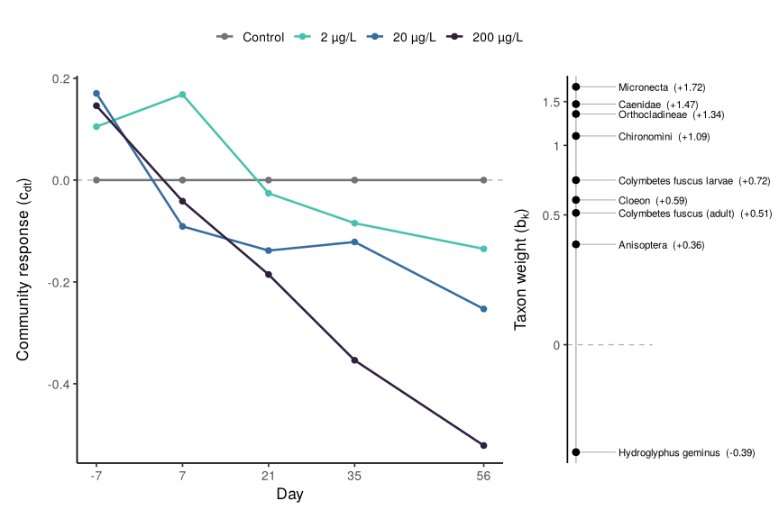

<!-- README.md is generated from README.Rmd. Edit README.Rmd and render it with devtools::build_readme() or rmarkdown::render("README.Rmd") after installing the package. -->

# *cosmet*

<!-- badges: start -->

[](https://github.com/STABLE-uv/cosmet/actions/workflows/R-CMD-check.yaml)
[](https://lifecycle.r-lib.org/articles/stages.html#experimental)
<!-- badges: end -->

*cosmet* analyses aquatic mesocosm and microcosm experiments with
chemicals, the classic way: it validates the design, compares every
treatment with the control for each taxon and sampling date (Williams’
or Dunnett’s test), derives no observed effect concentrations (NOEC)
with optional criteria for consistent effects, computes minimum
detectable differences (MDD), and fits and tests principal response
curves (PRC). For the measured exposure, it fits first-order dissipation
after each application (rate constants, DT50, DT90) and computes
time-weighted average concentrations. Results are data frames that keep
every intermediate decision (status of each taxon and date, criteria,
critical values), and plots follow the usual figures of mesocosm
studies.

## Installation

From GitHub, with its dependencies:

``` r
# install.packages("remotes")
remotes::install_github("STABLE-uv/cosmet", dependencies = TRUE)
```

## Example

The macroinvertebrates of the eutrophic-lake mesocosms of the
azoxystrobin experiment of Amador et al. (2024), included in the
package:

``` r
library(cosmet)

macro <- subset(azoxy, community == "macroinvertebrates" & habitat == "eutrophic_lake")
d <- meso_data(
  macro,
  mesocosm_col = "tank", time_col = "day", treatment_col = "concentration",
  concentration_col = "concentration", taxon_col = "taxon", value_col = "abundance",
  control = "0", zero_fill = FALSE, unit = "individuals/sample",
  concentration_unit = "µg/L", applications = c(0, 14)
)
d <- transform_response(d, A = 2)

# Population NOECs: Williams' test and the criteria of Text S11
tw <- test_control(d, method = "williams")
noec <- derive_noec(tw, pre_times = -7, criteria = s11_criteria("macroinvertebrates"))
noec_table(noec, selected = TRUE)
#>                       taxon   -7    7   21   35   56
#> 1               Chironomini <NA> <NA> <NA> <NA>  20↓
#> 2 Colymbetes fuscus (adult) <NA> <NA> <NA>   2↓ <NA>
#> 3  Colymbetes fuscus larvae <NA> <NA> <NA> <NA>   2↓
#> 4                Micronecta <NA> <NA>  20↓ <NA> <NA>

# Minimum detectable differences at the highest concentration, day 56
mdd <- calc_mdd(tw)
head(mdd[mdd$concentration == 200 & mdd$time == 56 & !is.na(mdd$mdd_pct),
         c("taxon", "effect_pct", "mdd_pct", "mdd_class")])
#>                         taxon effect_pct   mdd_pct mdd_class
#> 15                 Anisoptera  -80.52679 126.79815         0
#> 30                   Caenidae  -85.43269  82.65584        II
#> 60                Chironomini  -87.04420  85.51850        II
#> 75                     Cloeon -100.00000 112.59202         0
#> 90  Colymbetes fuscus (adult) -100.00000  88.43059        II
#> 105  Colymbetes fuscus larvae -100.00000  84.68090        II

# Principal response curves and their test
prc <- fit_prc(d)
prc
#> <meso_prc> principal response curves
#> 60 samples, 29 taxa; scale: ln(2 x + 1); scaling: symmetric
#> Variance explained by time: 26.9%, by treatment: 27.7%
#> First axis: 34.7% of the treatment variance (9.6% of the total)
#> Taxa with the largest weights:
#>                      taxon     bk
#>                 Micronecta  1.717
#>                   Caenidae  1.466
#>             Orthocladineae  1.340
#>                Chironomini  1.093
#>   Colymbetes fuscus larvae  0.716
#>                     Cloeon  0.586
#>  Colymbetes fuscus (adult)  0.511
#>       Hydroglyphus geminus -0.388
test_prc(prc, n_perm = 499)
#> <meso_prc_test>
#> First PRC axis: F = 8.473, p = 0.002 (499 permutations of whole time series)
#> Tests by time (RDA on treatment):
#>  time  n r_squared adj_r_squared    F p_value n_perm
#>    -7 12     0.346        0.1006 1.41   0.104    499
#>     7 12     0.306        0.0455 1.17   0.268    499
#>    21 12     0.363        0.1246 1.52   0.082    499
#>    35 12     0.455        0.2508 2.23   0.004    499
#>    56 12     0.425        0.2090 1.97   0.004    499
```

``` r
plot_prc(prc, xlab = "Day")
```



The measured azoxystrobin in the same mesocosms: dissipation after each
application, time-weighted average concentrations and comparison with
the nominal concentrations (`plot_exposure()` draws the series with the
fitted curves).

``` r
expo <- subset(azoxy_exposure, habitat == "eutrophic_lake")
e <- meso_exposure(
  expo, control = "0", applications = c(0, 14),
  mesocosm_col = "mesocosm", time_col = "day", treatment_col = "concentration",
  concentration_col = "concentration", value_col = "azoxystrobin",
  timing_col = "timing", unit = "µg/L"
)
dis <- fit_dissipation(e)
dis
#> <meso_dissipation>
#> First-order dissipation: log-linear regression of ln C; one rate constant per application; one fit per treatment
#> 95% confidence intervals (Wald, parameter uncertainty only; those of k in $estimates); k per d, DT50 and DT90 in d
#>  treatment period n C0 (% nominal) k      DT50 DT50 CI      DT90 status
#>  2 µg/L    1      9 2 (100%)       0.0582 11.9 [10.2, 14.3] 39.6 ok    
#>  2 µg/L    2      9 2.4 (120%)     0.0392 17.7 [14.6, 22.3] 58.7 ok    
#>  20 µg/L   1      9 20 (100%)      0.075  9.24 [7.46, 12.2] 30.7 ok    
#>  20 µg/L   2      9 20.4 (102%)    0.0546 12.7 [10.6, 15.7] 42.2 ok    
#>  200 µg/L  1      9 198 (99%)      0.0764 9.07 [7.41, 11.7] 30.1 ok    
#>  200 µg/L  2      9 217 (108%)     0.0618 11.2 [8.96, 15]   37.3 ok
twa <- calc_twa(e, windows = c(7, 14, 21, 56))
twa[c("treatment", "window", "twa", "twa_pct_nominal", "status")]
#>    treatment window        twa twa_pct_nominal status
#> 1          2      7   1.674281        83.71404     ok
#> 2          2     14   1.400198        70.00992     ok
#> 3          2     21   1.645078        82.25390     ok
#> 4          2     56   1.295334        64.76670     ok
#> 5         20      7  16.020235        80.10117     ok
#> 6         20     14  12.699558        63.49779     ok
#> 7         20     21  14.212555        71.06277     ok
#> 8         20     56  10.456149        52.28075     ok
#> 9        200      7 158.180481        79.09024     ok
#> 10       200     14 127.552992        63.77650     ok
#> 11       200     21 145.265605        72.63280     ok
#> 12       200     56 102.312510        51.15626     ok
compare_nominal(e)[c("treatment", "application", "after", "pct_nominal", "pct_added")]
#>   treatment application      after pct_nominal pct_added
#> 1         2           1   1.965941    98.29703        NA
#> 2         2           2   2.582520   129.12602  85.64544
#> 3        20           1  20.398624   101.99312        NA
#> 4        20           2  20.262207   101.31104  65.73144
#> 5       200           1 187.071948    93.53597        NA
#> 6       200           2 226.727415   113.36371  81.08271
```

## Methods and decisions

| Step      | Function                                                                  | Method                                                                                                                                                                                                                                                                                                                               | Decisions (argument)                                                                                                              |
|-----------|---------------------------------------------------------------------------|--------------------------------------------------------------------------------------------------------------------------------------------------------------------------------------------------------------------------------------------------------------------------------------------------------------------------------------|-----------------------------------------------------------------------------------------------------------------------------------|
| Data      | `meso_data()`                                                             | One row per mesocosm, time and taxon; observed zeros, unknown values and samples not taken are kept apart                                                                                                                                                                                                                            | Whether a taxon without a row is a zero (`zero_fill`, no default); analysed samples (`samples`)                                   |
| Scale     | `transform_response()`                                                    | ln(A x + 1) (van den Brink et al. 2000)                                                                                                                                                                                                                                                                                              | `A` (no default)                                                                                                                  |
| Tests     | `test_control()`                                                          | Step-down Williams test (Williams 1971, 1972) with a simulated null distribution, or Dunnett’s test (Dunnett 1955) by numerical integration                                                                                                                                                                                          | `method` (no default), `direction`, `alpha`, `step_variance` (Williams: variance of all groups or of the reduced design), `na_rm` |
| NOEC      | `derive_noec()`                                                           | LOEC and NOEC per taxon and date; criteria of consistent effects                                                                                                                                                                                                                                                                     | `criteria` (`noec_criteria()`, `s11_criteria()`), `pre_times`                                                                     |
| MDD       | `calc_mdd()`                                                              | Brock et al. (2015), eq. 2, 5 and 6, and their MDD classes                                                                                                                                                                                                                                                                           | —                                                                                                                                 |
| Community | `fit_prc()`, `test_prc()`, `community_noec()`                             | PRC (van den Brink and ter Braak 1999) with ‘vegan’; permutations of whole time series; Williams’ test on the first principal component of each date                                                                                                                                                                                 | `scaling`, `orientation`, `n_perm`, `seed`                                                                                        |
| Exposure  | `meso_exposure()`, `fit_dissipation()`, `calc_twa()`, `compare_nominal()` | One or several applications, the same for all the treatments or a schedule for each; first-order dissipation after each application, by regression of ln C or nonlinear least squares (FOCUS 2014); time-weighted averages by the trapezoidal rule or the fitted curves; measured concentrations as a percentage of the nominal ones | `applications`, `method`, `k_by` (one rate constant per application or for all), `by`, `windows`, `start`, `lag`                  |

The vignette (`vignette("cosmet")`) goes through the whole analysis and
explains each decision; the help pages give the equations and
references.

## Status

- The NOECs, LOECs, criteria and selections of
  `test_control(step_variance =   "reduced")` and `derive_noec()` are
  identical to those of the original analysis script of the authors on
  its simulated data and on the azoxystrobin macroinvertebrates of both
  habitats; the PRC weights, variance explained and permutation tests
  are identical to those of the original PRC script, and its
  coefficients differ by the constant factor that ‘vegan’ 2.6-6
  introduced (see NEWS).
- The simulated null distribution of Williams’ statistic agrees with the
  tables of Williams (1972) within Monte Carlo error; Dunnett’s
  probabilities agree with ‘mvtnorm’ and with nested numerical
  integration.
- The time-weighted averages of `calc_twa()` are identical to those of
  the original script for the 7-day windows; the longer windows differ
  by 0.4 % to 3 % because the profile now jumps at the second
  application, and the rate constants differ because the script averaged
  rates between sampling days (see NEWS).
- `R CMD check` runs on GitHub Actions on Linux, macOS and Windows
  (badge above). The minimum R version (4.1.0) has not been tested.

## Data

`azoxy` and `azoxy_exposure` come from Amador et al. (2024) under a CC
BY 4.0 licence: cite the article when you use them.

Amador P, Vega C, Navarro Pacheco NI, Moratalla-López J, Palacios J,
Crettaz Minaglia MC, López I, Díaz M, Rico A (2024). Effects of the
fungicide azoxystrobin in two habitats representative of Mediterranean
coastal wetlands: a mesocosm experiment. *Aquatic Toxicology* 267,
106828. <https://doi.org/10.1016/j.aquatox.2023.106828>
